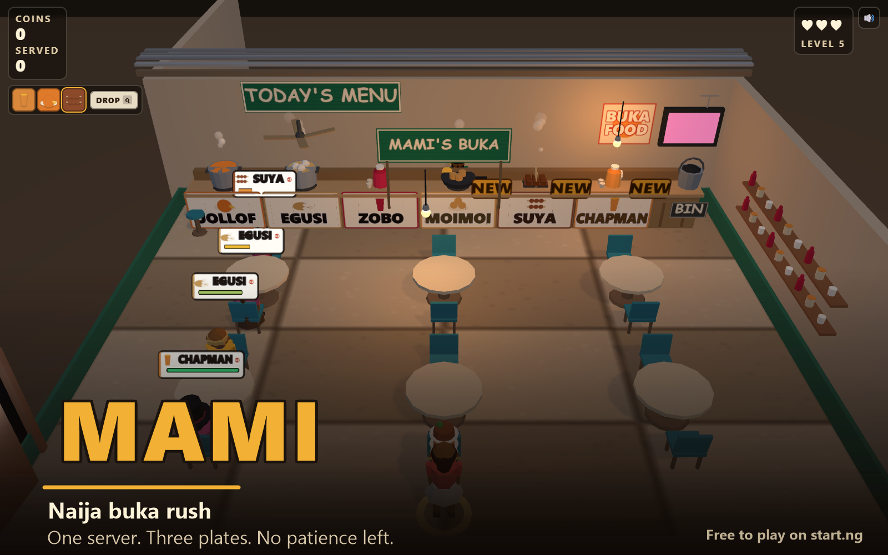

# MAMI — Naija buka rush

A low-poly 3D arcade game built with three.js. You are the only server in a
Nigerian *mami's buka* canteen: run the room, carry up to **three plates at
once**, and get everyone's order out before their patience runs out.

Everything is drawn from primitives in code — no models, no images, no fonts,
no build step, no network calls at runtime.



---

## Run it

The game is plain ES modules, so it must be served over HTTP (opening
`index.html` from the filesystem will not work — the browser blocks module
imports from `file://`).

```bash
npx serve .
```

Then open <http://localhost:3000>.

Any static server works just as well:

```bash
python -m http.server 8000     # then open http://localhost:8000
php -S localhost:8000          # then open http://localhost:8000
```

There is no build step and no install. three.js r160 is vendored at
`vendor/three.module.min.js` (MIT) and wired up with a relative import map in
`index.html`.

---

## How to play

| Action | Desktop | Touch |
| --- | --- | --- |
| Move | `W` `A` `S` `D` or arrow keys | drag anywhere on the **left** of the screen |
| Drop / bin the top plate | `Q` | the **DROP** button in the HUD |

- **Walk into a pickup point** to lift that dish onto the stack in your hands.
  You can carry **3 plates**; the stack sways as you run. Every pickup point has
  its own sign showing the dish icon, name and price — there is no guessing and
  nothing to cycle through.
- **Walk up to a seated customer** to hand them a plate. **Any** plate in your
  stack that matches their order will do, not just the one on top — that plate
  is removed and the rest slide down to fill the gap.
  * Right dish → they pay and leave happy.
  * Wrong dish → it stays in your hands and they lose patience faster.
- **Get rid of a plate you do not want** by walking into the **bin** at the end
  of the counter, pressing `Q`, or tapping **DROP**.
- The **patience bar** under each seated customer's order drains green → yellow →
  red. When it empties they storm off and you lose a life. **3 lives.**
- Later rounds get busier, customers get less patient, and orders grow to
  **two items**.

### The menu

There is exactly **one pickup point per dish**, along the counter. You start
with three and the rest unlock as the round goes on — an unlocking pickup point
lights up and shows a **NEW** sign.

| Dish | Pickup point | Unlocks at |
| --- | --- | --- |
| Jollof rice | the jollof pot | from the start |
| Egusi + pounded yam | the egusi pot | from the start |
| Zobo | the drinks jug | from the start |
| Moi moi | the frying pan | 40s |
| Suya | the skewer grill | 85s |
| Chapman | the drinks jug | 130s |

Customers only ever order dishes that are **unlocked and on the counter**, so
you are never asked for something you cannot pick up. A locked pickup point
cannot be collected from — its sign is drawn dark and crossed out.

---

## Project layout

```
index.html            import map + canvas (the only markup)
vendor/
  three.module.min.js three.js r160, vendored
src/
  main.js       start-up, input, game loop, screen switching, effects
  config.js     ALL tuning numbers live here
  game.js       rules and state: coins, lives, score, difficulty ramp
  scene.js      three.js scene, camera, lights, the canteen itself
  character.js  builds any character from ONE style object
  customers.js  spawning, seating, orders, patience
  ui.js         HTML/CSS overlays: title, HUD, game over, leaderboard, joystick
  audio.js      Web Audio synthesis (no sample files)
  platform.js   the start.ng bridge (whoami, sign-in, scores, leaderboard)
startng.json    leaderboard columns (coins, served)
```

### platform.js — the start.ng bridge

`src/platform.js` is the **only** file that talks to start.ng. The game uses
`getCurrentUser()`, `onUserChange(fn)` and `signIn()` (plus `saveScore()` and
`fetchLeaderboard()` at game over), so nothing else in the codebase knows how
sign-in works.

It talks to start.ng through its hidden connect page, `https://start.ng/connect`,
with `postMessage`, exactly as <https://start.ng/docs.md> describes. Every reply
is checked against **three** things before it is believed: `e.origin` (which
makes it trustworthy), `e.source` (so no other frame can answer for it), and the
`requestId` we generated (so a slow answer to an earlier question is not mistaken
for this one).

| What | How |
| --- | --- |
| who is playing | `startng:whoami` → `reply.user ?? reply.guest` |
| save a run | `startng:score` with `{ stats: { coins, served } }` |
| read the board | `startng:leaderboard` with `limit: 10` |
| sign in | `location.href = https://start.ng/?return_to=<this page>` |

**Your character.** The server *is* your start.ng character — there is no
character select and no randomiser in normal play.

| Who is playing | The player is |
| --- | --- |
| signed in | exactly `reply.user.style`, through `character.js` |
| a guest | `reply.guest.style` from start.ng's own reply, named **Guest** |
| start.ng did not answer | the built-in default style, named **Guest** |

Body, colours, hair, hat and accessory all carry over. `normaliseStyle()`
fills in anything missing or unrecognised, so a style value start.ng adds
later can never break the character builder.

**Identity changes land at the next round, not mid-round.** start.ng is re-asked
on `focus` and `visibilitychange`, because the player may have signed in or out
in another tab. If they did, the new look is held and applied by `beginRound()`
— swapping your body out from under you halfway through a round would be
jarring.

**Customers are not affected.** They keep rolling random styles; only the
server is a real player character.

The signed-in player's name and `@account` appear in a small quiet line in the
HUD. Guests see nothing there — the title screen already says **Guest**.

**Not answering is not "signed out".** If nothing replies within 4 seconds the
player simply stays a guest. There is no error, no spinner and nothing breaks —
which is what happens on localhost, and what would happen if start.ng were down.

**Off start.ng, nothing happens at all.** The connect frame is only ever created
when `location.hostname` ends in `.start.ng`. On `localhost`, a LAN IP or a
`file://` page the game loads no iframe, sends no requests and logs no errors: it
is a clean guest-only build. This is also how the automated tests run.

**Re-checks on return.** The player may sign in or out on start.ng in another
tab, so `startng:whoami` is asked again on `visibilitychange` and `focus`.

**Guests** get start.ng's own guest look, the name **Guest**, and a **Sign in**
button. If they arrived with `?guest` in the address — the start.ng homepage
adds that when someone chooses "play as a guest" — the sign-in button and the
end-of-round invitation are both hidden, because they already answered.

**Scores are never sent from `?test=1` or `?debug=1`.** Those are automated
runs; writing to a real player's leaderboard from a test would be wrong. Each
stat is also rounded and clamped to 0–1,000,000,000 before sending, because
start.ng refuses anything that is not a whole number in that range.

The only thing that exposes `window.__mami` is a literal `?debug=1`.

### startng.json — the leaderboard columns

```json
{
  "leaderboard": {
    "stats": [
      { "key": "coins",  "label": "Coins",       "order": "highest" },
      { "key": "served", "label": "Meals served", "order": "highest" }
    ]
  }
}
```

start.ng reads this when the game is published. Players are ranked by **coins**,
with **meals served** breaking ties. Only each player's best run is kept.

At game over a signed-in player's run is sent as exactly those two keys, as
whole numbers. The reply carries a rank, which the game-over screen shows. The
**Leaderboard** button (on the title and game-over screens) opens the top 10 and
highlights the player's own row.

### What I could not test locally

Honest list — none of this ran against a real signed-in start.ng account:

- **Sign-in.** I could not sign in, so the real round trip through
  `https://start.ng/?return_to=…` and back has never executed.
- **A real signed-in `startng:whoami` reply.** The "signed-in player" branch —
  the chip showing `@account`, the HUD name, hiding Sign in, hiding Shuffle my
  look — was verified by reading the code, not by seeing it.
- **Saving a score and getting a rank back.** `saveScore()` has never received a
  real `startng:scoreSaved` reply, so the rank line has never shown a real rank.
- **The leaderboard returning real entries.** It has only ever taken the
  "not available here" path, so the row highlighting has never met a real
  `player_id`.

**What I did test.** Served from a faked `mami-startng-test.start.ng` origin
(Chrome `--host-resolver-rules`), so the start.ng code path ran for real:

- `hostname` ends in `.start.ng`, so the connect frame **is** created, pointing
  at `https://start.ng/connect` — and off that origin it is never created at
  all (0 iframes on localhost).
- No signed-in player came back, and the game sat at **Guest / Not signed in**
  with **zero console errors** — "no answer" behaved as "guest", not as a
  failure.
- The leaderboard button opened and degraded gracefully; the game still played.
- `?test=1` sent no score, and `window.__mami` existed only under a literal
  `?debug=1` (checked across `''`, `?test=1`, `?debug=1`, `?test=1&debug=1`,
  `?guest`).

Two guards could only be checked by reading the code, not by running them: the
"never send a score under `?test=1`/`?debug=1`" rule on a **signed-in** player
(as a guest, `saveScore()` returns early anyway), and `startng.json` being
accepted, which only happens at publish time on a public repo.

### Pre-publish state

Checked against <https://start.ng/docs.md>. 14 files, 13 served, 1.32 MB.

| Rule | State |
| --- | --- |
| `index.html` at the top of the repo, already built | yes — plain ES modules, no bundler, no `needs_build` risk |
| Relative paths only | yes — `./src/main.js`, `./vendor/three.module.min.js` |
| Served file types | yes — `html js json png`. `README.md` is `.md`, which is not on the served list, so start.ng skips it (expected) |
| Size | 13 files / 1.32 MB (limits 2000 / 100 MB). Largest file 0.64 MB (limit 25 MB) |
| `vendor/three.module.min.js` committed | yes — so there is no `external_script` warning |
| No `http://` in a served file | yes |
| No secrets | yes — nothing at all; the only storage is the local best score |
| No password field | yes |
| No redirect on open | yes — the only `location.href` is the start.ng sign-in, behind a click |
| `cover.png` 16:10, ≥640×400, <2 MB | 1600×1000, 0.47 MB |
| `startng.json` valid | 2 stats, legal keys, labels ≤30 chars, `order: highest`; and `main.js` sends exactly `{ coins, served }` |
| Score values whole numbers 0–1e9 | clamped and rounded in `platform.js` before sending |
| Leaderboard `limit` 1–50 | clamped in `platform.js` |
| `whoami` with `e.origin` checked | yes, plus `e.source` and a `requestId` |
| Score never sent under `?test=1`/`?debug=1` | yes, and `window.__mami` needs a literal `?debug=1` |

`.gitignore` covers `shots/`, `profile/`, `node_modules/` and OS junk. It has no
pattern that can match `vendor/`, `cover.png`, `index.html` or `src/` — checked
with `git check-ignore` rather than by reading it.

Still to do by hand: push to a **public** repo, `POST https://api.start.ng/games/check`,
then `POST https://api.start.ng/games/publish` and open the returned
`approve_url`. Only start.ng can confirm the repo is public and that
`startng.json` is accepted.

### End of round

Everything that happens when the round ends sits in one function,
`onGameOver({ coins, served })` in `src/game.js`. It records the best score and
fans out to whatever the UI registered via `onGameOverHook(fn)`. The start.ng
score save hangs off that hook in `main.js`, and never blocks the game-over
screen: the screen is already up, and the rank line fills in only if start.ng
answers.

### Dev flags

Two URL query switches, neither of which is ever on in normal play:

| Flag | What it does |
| --- | --- |
| `?test=1` | crushes patience and spaces arrivals so a whole round (3 storm-outs → game over → Play again) plays out in well under a minute. Also stops the game sending a score to start.ng. Does **not** expose the debug hook. |
| `?debug=1` | exposes `window.__mami` (`snapshot()`, `grant()`, `place()`) so the game can be driven and asserted from an automated browser test, and shows the title screen's **Shuffle my look** button — in a real game your look is your start.ng character, so there is nothing to shuffle. Also stops the game sending a score to start.ng. |

`?test=1` alone deliberately does **not** expose `window.__mami`. Test mode is
"play a round fast"; the debug hook is a separate thing that needs its own flag,
so a test run does not silently carry a debug surface.

All of the flags are read from the URL in `config.js`, not `main.js`: every
module's body runs before `main.js`'s, so parsing them in `main.js` would leave
`platform.js` believing it was allowed to send scores for its whole module body.

At start-up the game also runs a dev check that logs to the console:

```
[mami] menu check ok — 6 dishes, 6 pickup points
```

If a dish could be ordered but had no pickup point (or vice versa) it logs a
`[mami] DISH/PICKUP MISMATCH` error instead, so a typo in the dish table is
obvious without taking the game down.

---

## Tuning

Everything you'd want to change for feel is in **`src/config.js`**:

| What | Where |
| --- | --- |
| the whole menu: names, prices, icons, pickup x, unlock times | `dishes` |
| how fast you run, how snappy you stop | `player.maxSpeed`, `player.acceleration`, `player.friction` |
| how the plate stack rides and re-stacks | `player.carryHeight`, `carryOffset`, `carrySpacing`, `carryTilt`, `reStackTime` |
| difficulty ramp | `customers.levels` (one row per stage: spawn gap, patience, order size, walk speed) |
| when the first customer walks in | `customers.firstSpawnDelay` |
| how crowded the room gets | `customers.maxActiveEarly` / `maxActiveLate` |
| penalty for a wrong dish | `customers.wrongDishPenalty`, `wrongDishCooldown` |
| how close you must be to deliver | `customers.seatRadius` |
| the bin | `bin.x`, `bin.z`, `bin.radius`, `bin.cooldown` |
| how big the order bubble is | `customers.bubbleScreenFraction` (+ `…Narrow`), `bubbleHeightDeep` / `bubbleHeightShallow` |
| how big the counter signs are | `sign.size` / `sign.portraitSize`, `sign.portraitY` |
| how long a "NEW" badge stays up | `newBadgeSeconds` |
| money | `game.baseTip`, `game.orderItemBonus`, `game.quickBonusMax`, and `dishes.*.price` |
| juice: squash, hop, shake | `feel.*` |
| camera angle and framing | `camera.position` / `camera.target`, `camera.portraitFov`, `portraitPosition` / `portraitTarget` |
| warmth and how many lights | `lights.*` |
| frame rate safety | `renderer.pixelRatioCap`, `renderer.shadows` |

---

## Performance notes

- Geometries and materials are cached and shared, and tagged `userData.cached`
  so a restart can dispose everything else without touching the cache.
- Pixel ratio is capped at 2.
- The scene is a single room with at most 9 customers (12 seats).
- Measured **60 fps** in Chrome on a laptop GPU with the room completely full —
  12 customers seated at once — and 60 fps in portrait on a 390×844 viewport.
- If a phone still struggles, set `renderer.shadows: false` in `config.js` —
  that is the single biggest cost.